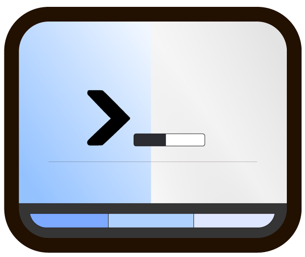

# zac (zsh-appearance-control)

[](https://github.com/alberti42/zsh-appearance-control/actions/workflows/tests-macos.yml)
[](https://github.com/alberti42/zsh-appearance-control/actions/workflows/tests-linux.yml)
[](https://github.com/alberti42/zsh-appearance-control/actions/workflows/verify-watcher.yml)
[](https://github.com/alberti42/zsh-appearance-control/releases/latest)
[](LICENSE)

<p align="center">
  
</p>

`zsh-appearance-control` keeps your shells and terminal tools in step with the light/dark appearance of macOS or of your Linux desktop. Switch the system to dark mode, and every open zsh switches, together with tmux, Neovim, Emacs, and any tool whose config file you choose to rewrite.

## What happens when you switch appearance

```
You switch macOS or GNOME to dark
  │
  ▼
watcher (e.g., zac-watch-macos, zac-watch-linux, tmux hooks, WezTerm, or a user-provided one)
  1. runs: appearance-dispatch dispatch 1
  │
  ▼
appearance-dispatch
  2. runs your io script once (ZAC_IO_CMD)     → rewrites config files: tmux, btop, …
  3. writes 1 to ~/.cache/zac/appearance       → Neovim and Emacs watch this file
  4. sends USR1 to every shell that loaded the plugin
  │
  ▼
each zsh that receives USR1
  5. at once: reads the cache file and runs
     ZAC_IMMEDIATE_CALLBACK_FNC                → env variables: FZF_DEFAULT_OPTS, LS_COLORS, …
  6. at the next prompt: runs
     ZAC_DEFERRED_CALLBACK_FNC                 → prompt redraw, anything heavier
```

The numbers in the diagram are the steps:

1. **A watcher** notices that the appearance changed and calls the dispatcher. This project ships one for macOS (`zac-watch-macos`, a launch agent) and one for Linux (`zac-watch-linux`, a systemd user service); both are attached to every [release](https://github.com/alberti42/zsh-appearance-control/releases/latest). tmux 3.6 or newer and WezTerm can do the same job from their own config. See [Choose a watcher](#choose-a-watcher).
2. **The dispatcher**, `bin/appearance-dispatch`, is the script every watcher calls. It first runs your io script, which rewrites the config files of your tools. See [Config files: the io script](#config-files-the-io-script).
3. It then writes the cache file.
4. Finally it signals the shells that loaded **the plugin**.
5. In each of them, the plugin reads the cache file and calls `ZAC_IMMEDIATE_CALLBACK_FNC` at once, inside the signal handler: this is where environment variables change.
6. At the next prompt, the plugin calls `ZAC_DEFERRED_CALLBACK_FNC`, for the prompt and anything heavier. See [Shell settings: the callbacks](#shell-settings-the-callbacks).

The cache file `$ZAC_CACHE_DIR/appearance` (default `~/.cache/zac/appearance`) is the single source of truth. It holds `1` for dark and `0` for light. The plugin reads it with a zsh builtin, so it never slows your prompt down, and any other program can read or watch it.

The plugin does not ask the OS for the appearance and does not poll. Without a watcher, `zac dark`, `zac light` and `zac toggle` change the OS appearance and update the shell you typed them in; other shells keep their old value.

## Quick start

1. [Install the plugin](#install-the-plugin).
2. Install the watcher for your OS, from the repository directory:

   ```zsh
   make watcher-install
   ```

   On macOS this builds the watcher with the Swift toolchain (Xcode command line tools). On Linux it needs GNOME 42 or newer, or a desktop whose `xdg-desktop-portal` implements `org.freedesktop.appearance` (KDE Plasma 5.24+).
3. Open a new terminal, switch the system appearance, and run `zac status`. It prints `1` for dark and `0` for light.

Your shells now know the appearance. To make your tools follow it, see [Make your tools follow](#make-your-tools-follow).

## Install the plugin

However you install it, set any `ZAC_*` environment variables *before* the plugin is loaded (usually in your `.zshrc`, above the plugin line).

### Oh My Zsh

Clone this repo into your Oh My Zsh custom plugins directory:

```zsh
git clone https://github.com/alberti42/zsh-appearance-control.git \
  "$ZSH_CUSTOM/plugins/zsh-appearance-control"
```

Then add it to your plugins list in `.zshrc`:

```zsh
plugins=(... zsh-appearance-control)
```

### zinit

```zsh
zinit lucid wait light-mode for \
    wait'0' \
    atinit"export ZAC_IMMEDIATE_CALLBACK_FNC=my_immediate_callback" \
    path/to/zsh-appearance-control
```

- `wait'0'` defers loading until after the first prompt, so the plugin does not slow down shell startup. If your prompt theme needs the appearance applied before the very first draw, remove `wait`.
- `atinit` sets `ZAC_IMMEDIATE_CALLBACK_FNC` before the plugin is sourced.

### Manual

Clone the repo anywhere you like, then source the entry file from `.zshrc`:

```zsh
source "/path/to/zsh-appearance-control/zsh-appearance-control.plugin.zsh"
```

### What happens when a shell starts

When the plugin loads, it reads the cache file and runs `ZAC_IMMEDIATE_CALLBACK_FNC`, so a new shell starts with the current appearance. If the callback function is not defined yet at that point (because `.zshrc` defines it after loading the plugin), it runs before the first prompt or command instead. `ZAC_DEFERRED_CALLBACK_FNC` runs at the first prompt.

## Choose a watcher

Something must call `bin/appearance-dispatch` when the appearance changes. That something is the *watcher*. Pick one; they all end in the same call.

| Watcher | Detects | Good when |
|---|---|---|
| [`zac-watch-macos`](#macos-zac-watch-macos) | the OS appearance | macOS, any terminal, including the automatic sunset switch |
| [`zac-watch-linux`](#linux-zac-watch-linux) | the desktop colour scheme | GNOME 42+, or any desktop with the appearance portal |
| [tmux hooks](#tmux-hooks-tmux-36-or-newer) | the theme of the attached terminal | you work inside tmux, also over ssh |
| [WezTerm](#wezterm) | the OS appearance | you use WezTerm |
| [your own](#your-own-watcher) | whatever you query | none of the above fits |

### macOS: zac-watch-macos

A small Swift program in `watchers/macos/` that runs as a launch agent. It observes the system appearance notification and calls the dispatcher, so it works with any terminal (Terminal.app, iTerm2, Ghostty), and it also fires when macOS switches appearance automatically at sunset.

```zsh
cd /path/to/zsh-appearance-control
make watcher-install IO_CMD=$HOME/path/to/your/io-script   # IO_CMD is optional
```

This builds the binary into `~/.local/bin`, writes `~/Library/LaunchAgents/com.github.alberti42.zac-watch-macos.plist`, and loads it.

```zsh
make watcher-status                       # is it loaded?
tail -f ~/Library/Logs/zac-watch-macos.log
make watcher-uninstall
```

If you do not want to build it, each release attaches a signed and notarized universal binary as `zac-watch-macos-<tag>-macos-universal.zip`; [`watchers/macos/README.md`](watchers/macos/README.md) describes how to install it by hand, and the remaining settings.

### Linux: zac-watch-linux

A zsh script in `watchers/linux/` that watches the desktop colour-scheme preference over D-Bus. There is nothing to build.

It requires a desktop that has such a preference: **GNOME 42 or newer** (Ubuntu 22.04+, Fedora 36+), or any desktop whose `xdg-desktop-portal` implements `org.freedesktop.appearance` (KDE Plasma 5.24+). It must run inside the graphical session.

```zsh
cd /path/to/zsh-appearance-control
make watcher-install IO_CMD=$HOME/path/to/your/io-script   # IO_CMD is optional
```

`make` chooses how the watcher starts: as a systemd user service when your session is integrated with `systemd --user`, as an XDG autostart entry when it is not (NX, xrdp, VNC). Force one with `LINUX_LAUNCHER=systemd|autostart`.

```zsh
make watcher-status
journalctl --user -u zac-watch-linux -f   # systemd launcher only
make watcher-uninstall
```

Each release attaches it as `zac-watch-linux-<tag>.zip`. See [`watchers/linux/README.md`](watchers/linux/README.md) for the backends, the two launchers and troubleshooting.

### What `IO_CMD` does at install time

The watcher runs outside your shell, so it cannot see variables you export in `.zshrc`. `make watcher-install` writes the values it needs into the launcher (the plist, the systemd unit or the autostart entry):

- `IO_CMD=…` becomes `ZAC_IO_CMD`, your [io script](#config-files-the-io-script). Without it the watcher updates the appearance file and signals your shells and nothing else: config files (tmux, btop, editors) stop following the theme. The install prints a note when it is missing.
- `ZAC_CACHE_DIR` is taken from the environment you run `make` in, so run it from a shell where your plugin settings are loaded.

To change either later, run `make watcher-install` again.

### tmux hooks (tmux 3.6 or newer)

tmux asks the terminal about its theme and fires a hook when it changes. This works for local sessions, and also for a session you attached over ssh, because the report comes from your local terminal through the same connection. On terminals that do not report their theme (mode 2031), tmux guesses it from the background colour.

Add this to your tmux config, with the path adjusted to your install:

```tmux
ZAC_BIN="$HOME/path/to/zsh-appearance-control/bin/appearance-dispatch"

# Optional: your io script. Drop the env prefix if you have none.
ZAC_IO="$HOME/path/to/your/io-script"

set-hook -g client-dark-theme  "run-shell -b 'env ZAC_IO_CMD=$ZAC_IO $ZAC_BIN dispatch 1'"
set-hook -g client-light-theme "run-shell -b 'env ZAC_IO_CMD=$ZAC_IO $ZAC_BIN dispatch 0'"
```

- `run-shell` runs `/bin/sh` with the environment of the tmux **server**, so use an absolute path for the dispatcher and pass `ZAC_IO_CMD` explicitly.
- `-b` runs the command in the background, so tmux never waits for it.
- The hooks also fire when a client attaches, which is what you want after a restart.
- Check your version with `tmux -V`, and check the hooks exist with `tmux show-hooks -g | grep theme`.
- If nothing happens, your terminal probably does not report theme changes and the background-colour guess did not trigger. Use one of the other watchers.

### WezTerm

WezTerm can run a command when the system appearance changes:

```lua
local wezterm = require 'wezterm'
local home = os.getenv('HOME')

local function scheme_for_appearance(appearance)
  local is_dark = appearance:find('Dark') ~= nil

  -- WezTerm is a GUI app: it does not inherit your shell environment, so pass
  -- ZAC_IO_CMD explicitly, and extend PATH with the directories your io script
  -- needs (e.g. /opt/homebrew/bin). Drop the ZAC_IO_CMD line if you have none.
  wezterm.run_child_process({
    'env',
    'PATH=/opt/homebrew/bin:' .. os.getenv('PATH'),
    'ZAC_IO_CMD=' .. home .. '/path/to/your/io-script',
    home .. '/path/to/zsh-appearance-control/bin/appearance-dispatch',
    'dispatch', is_dark and '1' or '0',
  })

  return is_dark and 'My Dark Scheme' or 'My Light Scheme'
end

wezterm.on('window-config-reloaded', function(window, pane)
  local overrides = window:get_config_overrides() or {}
  overrides.color_scheme = scheme_for_appearance(window:get_appearance())
  window:set_config_overrides(overrides)
end)
```

### Your own watcher

Any program can be the watcher. When the appearance changes, it runs:

```
/path/to/zsh-appearance-control/bin/appearance-dispatch dispatch <1|0>
```

with `ZAC_IO_CMD` (and `ZAC_CACHE_DIR`, if you changed it) in its environment. Calling it twice with the same value is harmless: the io script runs only on a real change.

## Make your tools follow

There are three places to hook in. The right one depends on what you are trying to do.

| Hook | Runs | Use for |
|---|---|---|
| `ZAC_IO_CMD` | Once, in the dispatcher, before shells are signaled | Writing config files to disk |
| `ZAC_IMMEDIATE_CALLBACK_FNC` | In every shell, immediately on signal | Updating env vars and shell settings |
| `ZAC_DEFERRED_CALLBACK_FNC` | In every shell, at the next prompt | Prompt redraws, anything heavier |

Programs that watch files, such as Neovim and Emacs, need none of these: they watch the cache file.

### Shell settings: the callbacks

**`ZAC_IMMEDIATE_CALLBACK_FNC`** is a shell function called directly inside the signal handler in every shell, before the next prompt redraws. It receives `1` for dark and `0` for light.

Allowed: `export`, `typeset`, `zstyle`, and `source` of files that only contain variable assignments.
Not allowed: I/O, subshells, pipes, or external commands — these can hang or corrupt shell state inside a signal handler.

```zsh
my_immediate_callback() {
  local is_dark=$1

  if (( is_dark )); then
    export FZF_DEFAULT_OPTS='--color=bg+:#1f2430,fg:#c8d3f5,hl:#82aaff'
  else
    export FZF_DEFAULT_OPTS='--color=bg+:#f2f2f2,fg:#2d2a2e,hl:#005f87'
  fi
}

export ZAC_IMMEDIATE_CALLBACK_FNC=my_immediate_callback
```

**`ZAC_DEFERRED_CALLBACK_FNC`** is a shell function called at the next `precmd`/`preexec` boundary in every shell. Safe for anything: prompt redraws, plugin reconfiguration, external tool calls.

```zsh
my_deferred_callback() {
  local is_dark=$1
  # safe to call external tools, redraw prompt, etc.
}

export ZAC_DEFERRED_CALLBACK_FNC=my_deferred_callback
```

### Config files: the io script

`ZAC_IO_CMD` is the path of an executable that the dispatcher runs once per appearance change, before signaling any shell, as `<script> <0|1>`. Use it for anything that writes to files on disk: tool config files, theme files, JSON settings. By the time shells receive the signal, the files are already updated.

```zsh
#!/bin/zsh
# Called by appearance-dispatch as: <script> <0|1>
is_dark=$1

# tmux: set the option your tmux theme reads (see the tmux section).
command tmux set-option -gq @dark_appearance "$is_dark" 2>/dev/null

# Add one block per tool that keeps its theme in a config file.

exit 0
```

- `ZAC_IO_CMD` is read by `bin/appearance-dispatch`, not by the plugin. Give it to your watcher (`make watcher-install IO_CMD=…`, or `env ZAC_IO_CMD=…` in a tmux or WezTerm hook); exporting it in `.zshrc` has no effect.
- It must be a single executable path. If you need to pass arguments or set environment variables, write a small wrapper script.
- Use `#!/bin/zsh` (without `-f`) as the shebang so that your `.zshenv` is sourced and your usual `PATH` and variables are available.
- **A non-zero exit aborts the whole dispatch**: the cache file is not written and no shell is signaled. Make each step skip a tool that is not installed on this host rather than fail.

### tmux

tmux is a consumer of the appearance, like Neovim, Emacs or fzf. Neither the plugin nor the dispatcher touches any tmux option: you set `@dark_appearance` from your io script (the example above does), and your tmux theme reads it.

Your io script only runs on a real change, so a tmux server that starts later has no option set. Read the file once at server start to cover that:

```tmux
run-shell -b 'f="${ZAC_CACHE_DIR:-${XDG_CACHE_HOME:-$HOME/.cache}/zac}/appearance"; \
  [ -r "$f" ] && tmux set-option -gq @dark_appearance "$(cat "$f")"'
```

Then define your theme colours in terms of `@dark_appearance` (`1` for dark, `0` for light). [`examples/tmux/catppuccin.conf`](examples/tmux/catppuccin.conf) is a complete theme you can copy; it is also attached to each release.

### Neovim

Neovim can watch the cache file with its built-in libuv bindings (`vim.uv`), so you do not need to install any Neovim plugin. On an older Neovim without `vim.uv`, replace it with `vim.loop`. The technique comes from [Henrik Sommerfeld's write-up](https://www.henriksommerfeld.se/neovim-automatic-light-dark-mode-switcher/).

Save this as `~/.config/nvim/auto-color-scheme.lua`, and load it from `init.lua` with `dofile(vim.fn.stdpath("config") .. "/auto-color-scheme.lua")`:

```lua
local uv = vim.uv

local function zac_appearance_file()
  local cache = os.getenv("ZAC_CACHE_DIR")
  if not cache or cache == "" then
    cache = (os.getenv("XDG_CACHE_HOME") or (os.getenv("HOME") .. "/.cache")) .. "/zac"
  end
  return cache .. "/appearance"
end

local function read_mode(path)
  local f = io.open(path, "r")
  if not f then
    return "0"
  end
  local line = f:read("*line") or "0"
  f:close()
  return line
end

local function apply_mode(mode)
  if mode == '1' then
    vim.o.background = 'dark'
    pcall(vim.cmd.colorscheme, 'catppuccin-macchiato')
  else
    vim.o.background = 'light'
    pcall(vim.cmd.colorscheme, 'catppuccin-frappe')
  end
end

local path = zac_appearance_file()

-- Apply once on startup.
vim.schedule(function()
  apply_mode(read_mode(path))
end)

-- Watch for changes.
local handle = uv.new_fs_event()
if handle then
  uv.fs_event_start(handle, path, {}, function(err)
    if err then
      return
    end
    vim.schedule(function()
      apply_mode(read_mode(path))
    end)
  end)
end
```

### Emacs

[`editors/emacs/zac-theme-autodetection.el`](editors/emacs/zac-theme-autodetection.el) (also attached to each release) watches the cache file and calls a function you supply whenever the appearance changes. It needs no extra packages beyond what Emacs provides. It applies the theme at load time, supports the daemon and `emacsclient` (via `after-make-frame-functions`), and prints a message if file notifications are not supported.

Set `zac-load-theme-callback` **before** loading the module, so it is also used for the initial application:

```elisp
(add-to-list 'load-path "/path/to/editors/emacs")

;; It receives :light or :dark.
(setq zac-load-theme-callback
      (lambda (appearance)
        (load-theme (if (eq appearance :light)
                        'modus-operandi
                      'modus-vivendi-tinted) t)))

;; Load the module. The watcher starts automatically.
(require 'zac-theme-autodetection)
```

`modus-operandi` and `modus-vivendi-tinted` are built into Emacs 28+. Swap them for any theme you prefer.

Some packages do not pick up face changes when a theme switches. In Emacs 29+, fix their faces in `enable-theme-functions`, and register the hook before loading the module so it also runs on the initial application:

```elisp
(defun my/harmonize-theme (&rest _)
  "Re-apply custom face settings after every theme change."
  ;; e.g. (set-face-background 'git-gutter:added (face-background 'line-number nil t))
  )

(add-hook 'enable-theme-functions #'my/harmonize-theme)
```

### A complete real-world setup

[`examples/dotfiles/`](examples/dotfiles/) holds the author's actual configuration — a snapshot from a private dotfiles repository, warts included. It shows every hook above working together:

| File | Role |
|---|---|
| [`zac.zsh`](examples/dotfiles/zac.zsh) | zinit load with turbo mode, and an immediate callback that sets `LS_COLORS`, `FZF_DEFAULT_OPTS`, `BAT_CONFIG_PATH`, `zle_highlight` and completion colours |
| [`zac-io-cmd.zsh`](examples/dotfiles/zac-io-cmd.zsh) | an io script that rewrites configs for yazi, btop, patina, claude, opencode and IPython, and skips a tool that is not installed rather than failing |
| [`zac-tmux-cmd.zsh`](examples/dotfiles/zac-tmux-cmd.zsh) | the tmux options, in one helper shared by the io script and by `tmux.conf` at server start |

These are reading material, not a drop-in: they assume that repository's paths, helpers and tool list. See [`examples/dotfiles/README.md`](examples/dotfiles/README.md) for what to copy and what to replace.

## Remote hosts: ssh-tmux

The plugin provides `ssh-tmux`. It works like `ssh` (same arguments), but it attaches to a remote tmux session (default name `main`) and hands your local appearance to the remote host. On the remote host it calls `appearance-dispatch` when that is installed, so remote shells that already run are signalled too; otherwise it writes the remote cache file directly.

| Remote session | At connect | While the session stays open |
|---|---|---|
| With tmux 3.6 hooks on the remote host | correct | follows your local terminal, because the hook runs there |
| Plain ssh, or older tmux | correct | stays as it was at connect |

A plain ssh session gets the appearance you had when you connected, and keeps it. Reconnect to pick up a change. The design note [`docs/design-tmux-independence.md`](docs/design-tmux-independence.md) explains why.

## Reference

### The `zac` command

- `zac status` prints `1` for dark and `0` for light. If the value is unknown, it still prints `0` and exits with a non-zero status.
- `zac sync` refreshes the cached value from the cache file.
- `zac dark`, `zac light`, `zac toggle` ask your OS to switch appearance (macOS, or GNOME through `gsettings`), and then update the current shell immediately. Other shells follow when your watcher reports the change.
- `zac debug console` shows a live log stream; see [Debugging](#debugging).

### Configuration

Set these before the plugin is loaded:

| Variable | Meaning |
|---|---|
| `ZAC_IMMEDIATE_CALLBACK_FNC` | name of a function called inside the signal handler (env var assignments only) |
| `ZAC_DEFERRED_CALLBACK_FNC` | name of a function called at the next precmd/preexec (safe for anything) |
| `ZAC_CACHE_DIR` | where to store the cache file and the pid registry (default `$XDG_CACHE_HOME/zac`, else `~/.cache/zac`) |
| `ZAC_LINUX_DESKTOP` | `gnome` to force GNOME support for `zac dark/light`, `none` to disable it |
| `ZAC_DEBUG` | `1` to enable debug logging |
| `ZAC_ENABLE_SSH_TMUX` | `0` to disable `ssh-tmux` |
| `ZAC_SSH_TMUX_SESSION` | remote tmux session name for `ssh-tmux` (default `main`) |

`ZAC_CALLBACK_FNC` is accepted as a legacy alias for `ZAC_DEFERRED_CALLBACK_FNC`.

These are read by `bin/appearance-dispatch`, so they belong in the watcher's environment:

| Variable | Meaning |
|---|---|
| `ZAC_IO_CMD` | path to an executable run once per appearance change, called as `<script> <0|1>` |
| `ZAC_CACHE_DIR` | as above; must match the plugin's value |
| `ZAC_CACHE_ATOMIC` | `1` to replace the cache file on each write instead of overwriting it in place |

### `bin/appearance-dispatch`

```
bin/appearance-dispatch dispatch <on|off|1|0|true|false>
```

On each call it:

1. Runs `ZAC_IO_CMD` once if the appearance changed (skipped if already applied).
2. Writes the cache file.
3. Signals all registered shells with `USR1`.

If `ZAC_IO_CMD` fails, the pipeline stops after step 1: no cache write, no signals. Your config files and your shells therefore never disagree.

The dispatcher only signals shells that loaded this plugin and registered themselves. `USR1` terminates a process that has no handler for it, so signalling an unrelated shell would kill it.

The sub-commands `tmux` and `cache` are deprecated spellings of `dispatch`, kept so that old watcher scripts keep working. Neither sets a tmux option.

By default the cache file is overwritten in place, so it stays the same file on disk and tools can watch the file itself. With `ZAC_CACHE_ATOMIC=1` the dispatcher writes a temporary file and renames it into place, so a reader never sees a half-written value; tools must then watch the directory, because the file is replaced on every write.

### Debugging

```zsh
export ZAC_DEBUG=1    # before the plugin loads
zac debug console     # in one terminal: live log while you switch appearance
```

For the watchers, see the log commands in [Choose a watcher](#choose-a-watcher) and the debugging sections of [`watchers/macos/README.md`](watchers/macos/README.md#debugging) and [`watchers/linux/README.md`](watchers/linux/README.md#debugging).

## Author

- **Author:** Andrea Alberti
- **GitHub Profile:** [alberti42](https://github.com/alberti42)
- **Donations:** [](https://buymeacoffee.com/alberti)

Feel free to contribute to the development of this plugin or report any issues in the [GitHub repository](https://github.com/alberti42/zsh-appearance-control/issues).

## License

This project is licensed under the MIT License. See the [LICENSE](LICENSE) file for details.
